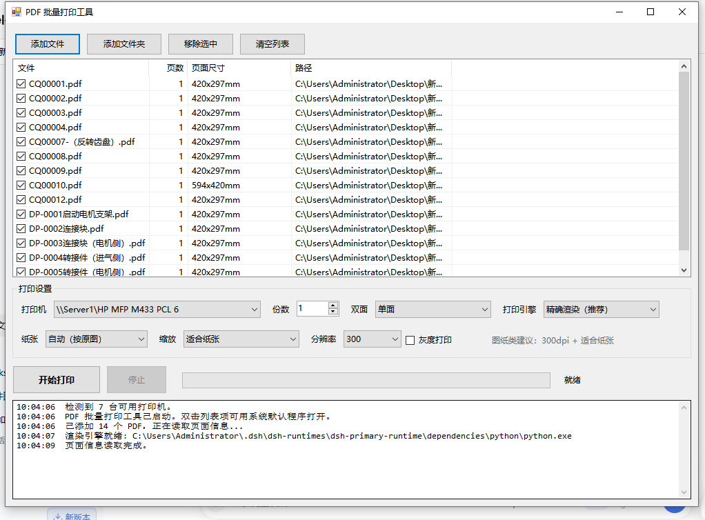

# PDF 批量打印工具

一个绿色小巧的 Windows 批量打印工具：把一个文件夹里的 PDF（尤其是 A3/A2 图纸）和图片（照片、扫描件、截图）
一次性排队打印，自动识别每页纸张大小、自动横竖方向、按纸张缩放，避免"图被裁掉/缩成一半"。

- 程序：`PdfBatchPrint.exe`（单文件，无需安装，Win7+ / .NET Framework 4.x）
- 源码：`src\PdfBatchPrint.cs`
- 重新编译：双击 `build.cmd`（用系统自带 csc.exe）
- 页面渲染脚本：`render_pdf.py`（需要 Python + PyMuPDF，见下）



> 单文件 exe，绿色免安装：PDF 和图片混排、A2/A3/A4 自动纸张与横竖、发票「每页 2 张」合并裁白边、逐页打印预览。

**目录**： [图形界面](#一图形界面用法推荐) · [命令行](#二命令行用法可做批处理计划任务) · [运行环境](#三运行环境) · [常见问题](#四常见问题) · [目录结构](#五目录结构) · [便携版](#六便携版拷到别的电脑上用) · [从源码构建](#七从源码构建) · [更新日志](#八更新日志) · [许可证](#九许可证)

## 一、图形界面用法（推荐）

1. 双击 `PdfBatchPrint.exe`
2. 「添加文件」或「添加文件夹」（支持 PDF 和图片，可混着加；也可直接把文件/文件夹拖进窗口；
   把文件或文件夹拖到 exe 图标上、或用 `PdfBatchPrint.exe "D:\图纸"` 启动，会直接加载）
3. 选择打印机（打印机下拉框会列出系统所有打印机）
4. 设置：份数、单双面、纸张、方向、边距、缩放、分辨率、灰度、**合并**（打发票用）
5. 「打印预览」逐页看实际排版效果（哪块会被裁掉会用红色标出来），确认没问题
6. 「开始打印」

列表会显示每个文件的页数和每页尺寸（mm），确认没问题再打印。

### 各选项说明

| 选项 | 默认 | 说明 |
| --- | --- | --- |
| 打印引擎 | 精确渲染 | 把每页渲染成图片再交给打印机，能正确处理 A3、横向、缩放，最可靠 |
| | WPS 原样打印 | 调用 wpspdf 自己打印，保留矢量精度，但纸张/缩放由 WPS 决定，容易走默认 A4 |
| 纸张 | 自动 | 页面最大边 > 310mm 用 A3，否则 A4；也可强制 A4/A3/A5/Letter |
| 方向 | 自动（按图纸） | 每一页单独判断：页面宽 > 高用横向，反之用纵向；也可强制「横向」或「纵向」（强制时图纸会旋转后放进该方向） |
| 边距 | 1 mm | 在可打印区里再留出的安全边距（毫米）。真实打印机的可打印区比纸面小（HP M433 四周约 4.2mm），A3 图缩到 A4 时底部最容易贴边被裁；遇到「最下面看不到」就把边距调大到 3~5mm |
| 缩放 | 适合纸张 | 等比缩放并居中，保证整张图完整；实际大小则按 1:1，超出纸张的部分会被裁掉 |
| 分辨率 | 300 | 300 dpi 已足够图纸；A3 300dpi 约 5000×3500 像素，文件/内存都不大 |
| 灰度 | 关 | 图纸多为黑白线条，开灰度能省墨、加快渲染 |
| 合并 | 不合并 | 把多个 PDF（电子发票最典型）拼到一张 A4 上再打印：每页 1 张 / 每页 2 张（发票推荐）/ 每页 4 张。合并是矢量的，不栅格化，放大也清晰 |
| 裁掉白边 | 开 | 合并时先自动识别每张发票的实际内容范围（文字+线条+图片），把四周空白裁掉再排版，一张 A4 能放得更满 |
| 合并另存… | — | 只生成合并后的 PDF 存到你选的位置，先看效果不打印 |

### 图片打印（png / jpg / bmp / gif / tif / webp）

图片和 PDF 混在一个列表里一起打印，规则和 PDF 完全一样（纸张、方向、边距、缩放、合并、预览都适用）。

- **支持格式**：png、jpg/jpeg、bmp、gif、tif/tiff、webp（webp 需要本机有 Pillow；便携包已带）；
- **页尺寸怎么来**：按图片文件里记录的 dpi 换算成毫米。没有 dpi 信息的按 96dpi 算
  （例如 1200×800 的图片 → 317×212mm）；
- **手机/相机照片常见坑**：照片常标 72~96dpi，换算出来会超过 A3，于是「纸张=自动」会选 A3。
  想打 A4 就把「纸张」直接选 A4，再把「缩放」保持「适合纸张」，图会等比铺满 A4，不会被裁；
- **一张图一页**：多选 n 张图片就是 n 页（1 文件 = 1 页），不需要先转 PDF；
- **想拼版**：用「合并」每页 2 张 / 4 张，图片和发票 PDF 可以混着拼；
- **WPS 引擎打图片**：会先把图片转成临时 PDF 再交给 WPS，打印完自动删除临时文件。

### 打印预览（开始打印旁边的按钮）

点「打印预览」会按当前的纸张/方向/边距/缩放/合并设置，把勾选的文件逐页画出来（110dpi，只用于看版式）：

- 白纸 + 蓝虚线：蓝虚线框是**打印机真正的可打印区**（HP M433 四周约 4.2mm），不是纸张边缘；
- 红块：这一块超出了可打印区，打印时会被裁掉——看到红色就调大「边距」或换更大的纸张；
- 底部按钮：上一页 / 下一页 / 缩小 / 放大 / 适应窗口 / 关闭（Esc 关闭，PageUp/PageDown 翻页，Ctrl+滚轮缩放）；
- 合并开启时，预览的是**合并后**的结果（12 张发票 → 6 页，每页 2 张），和实际打印一致；
- 预览固定用「精确渲染」引擎，与「WPS 原样打印」的最终效果可能略有差异；预览不产生打印任务，不浪费纸。

## 二、命令行用法（可做批处理/计划任务）

```bat
:: 把整个文件夹（含子目录）的 PDF 和图片全部打印到指定打印机
PdfBatchPrint.exe --cli --folder "D:\图纸" --printer "HP MFP M433 PCL 6"

:: 打印一组图片（也可以和 PDF 混着写）
PdfBatchPrint.exe --cli --files "a.jpg;b.png;c.webp" --printer "HP MFP M433 PCL 6" --paper A4

:: 指定若干文件
PdfBatchPrint.exe --cli --files "a.pdf;b.pdf" --printer "HP MFP M433 PCL 6" --paper A3 --dpi 300

:: 打印到 PDF，用于先看效果不浪费纸
PdfBatchPrint.exe --cli --files "a.pdf" --printer "Microsoft Print to PDF" --print-to-file "D:\预览.pdf"

:: 强制全部按纵向打印（默认 auto 会按每张图纸自动横竖）
PdfBatchPrint.exe --cli --folder "D:\图纸" --printer "HP MFP M433 PCL 6" --orient portrait

:: A3 图缩到 A4 打、底部总被裁：把安全边距调大
PdfBatchPrint.exe --cli --folder "D:\图纸" --printer "HP MFP M433 PCL 6" --paper A4 --margin 3

:: 发票：每张 A4 排 2 张、裁掉白边，再批量打印
PdfBatchPrint.exe --cli --files "a.pdf;b.pdf;c.pdf" --printer "HP MFP M433 PCL 6" --merge 2up --crop-invoice 1 --paper A4

:: 只把 12 张发票合并成一个 PDF 存起来（不打印），先看效果
PdfBatchPrint.exe --cli --files "a.pdf;b.pdf" --merge 2up --crop-invoice 1 --save-merged "D:\合并发票.pdf" --printer "Microsoft Print to PDF" --print-to-file "D:\临时.pdf"
```

全部参数：`PdfBatchPrint.exe --help`

退出码：0 = 全部成功，1 = 有失败，2 = 参数错误，3 = 缺少 Python 环境。

## 三、运行环境

### 必需
- Windows + .NET Framework 4.x（Win8/10/11 自带）

### 「精确渲染」引擎需要 Python + PyMuPDF
本机已自带可用环境，程序会自动查找，**一般无需配置**：

- 优先用界面里/命令行 `--python` 指定的路径
- 环境变量 `PDFBATCH_PYTHON`
- 程序目录下 `python\python.exe`
- `%USERPROFILE%\.dsh\dsh-runtimes\...\python.exe`
- `C:\Python312`、`C:\Python311`、PATH 里的 python

如果需要自己装：

```bat
pip install pymupdf
```

程序会自检 PyMuPDF 是否可导入，找不到会给出提示（此时仍可用「WPS 原样打印」引擎）。

### 「WPS 原样打印」引擎
需要本机装有 WPS Office（用 .pdf 的文件关联来打印），纸张和缩放由 WPS 控制。

## 四、常见问题

**Q: 打印出来的图被缩得很小 / 四周留白很大？**
A: 检查「纸张」是否被 WPS 或打印机驱动设成了 A4。用「精确渲染」+「纸张：自动」+「缩放：适合纸张」即可铺满 A3。

**Q: 图被裁掉一部分？**
A: 「缩放」设成了「实际大小」。改回「适合纸张」，或把纸张调大。

**Q: A3 的图缩到 A4 打，最下面被裁掉了？**
A: 1.1 版已修正排版偏移，并把「边距」默认设为 1mm。原因：真实打印机的可打印区比纸面小
   （HP M433 四周约 4.2mm），旧版把图按整页坐标定位，等于整体往下、往右各偏了 4.2mm，
   底部那 3mm 就被驱动裁掉了。现在按可打印区左上角定位，四周至少留 1mm。
   还嫌挤就把「边距」调成 3mm 或 5mm（命令行 `--margin 3`）再打一次；
   打之前也可以先用「Microsoft Print to PDF」印一份 PDF 对照看效果，不费纸。

**Q: 图纸有横有竖，需要分开打印吗？**
A: 不需要。「方向：自动（按图纸）」会对**每一页**单独判断：宽大于高就横向，高大于宽就纵向，
   同一批里横竖混排也不会错。日志里会为每个文件打印「页面 420x297mm → 横向 / A3」，可以先核对再打。
   如果全部要统一成横向或纵向，把「方向」改成「横向」/「纵向」即可。

**Q: A2 的图（如 CQ00010.pdf）怎么打？**
A: 本机打印机最大只支持 A3，A2 会被等比缩小到 A3（约 71%）。要 1:1 只能换 A2 幅面的打印机或分块打印。

**Q: 电子发票能不能几张拼一张 A4 打？**
A: 能。把发票 PDF 都加进列表，「合并」选「每页 2 张（发票推荐）」，勾上「裁掉白边」（默认已勾），
   纸张选 A4 → 开始打印。12 张发票会变成 6 页 A4，每页上下各一张，白边已被裁掉。
   想先看效果就点「合并另存…」，只生成 PDF 不打印（命令行 `--merge 2up --save-merged "D:\合并发票.pdf"`）。
   一张 A4 想放 4 张就选「每页 4 张」，但发票上的字会偏小。

**Q: 图片能打吗？支持哪些格式？**
A: 能，和 PDF 混在一个列表里一起打。支持 png / jpg / jpeg / bmp / gif / tif / tiff / webp。
   「添加文件」「添加文件夹」、拖拽、命令行 `--files`/`--folder` 都认这些格式，
   一张图算 1 页，纸张/方向/边距/缩放/合并/预览全部照常生效。

**Q: 一张 A4 照片，打出来却按 A3 排了？**
A: 图片的"页尺寸"是按文件里记录的 dpi 换算的，照片常标 72~96dpi，换算后会超过 A3，
   于是「纸张：自动」选了 A3。把「纸张」直接选 A4（命令行 `--paper A4`），
   缩放保持「适合纸张」，就会等比铺满 A4。同理，扫描件标 300dpi 时尺寸会小很多，也不用奇怪。

**Q: 打印图片提示"无法识别图片格式"？**
A: 极少数格式（如 webp）MuPDF 不认，程序会自动改用 Pillow 转换；如果提示这句，
   说明这台机器没有 Pillow。把图片另存成 png/jpg 再打即可，或安装 Pillow：
   `pip install pillow`（便携包里的 python 已带）。

**Q: 勾了「裁掉白边」再合并，发票最右边的边框线 / 彩色边条不见了？**
A: 1.4 早期版本有这个 bug：自动裁白边只按文字、图形的位置算内容框，而竖边框线宽度是 0，
   被当成"空矩形"忽略掉了，于是右边框正好落在内容框外被裁掉。现在改成手工合并矩形并向外多留 1pt，
   右边框和彩色边条都会保留。如果还发现有内容被裁，把「裁掉白边」临时取消，对比一下就知道了。

**Q: 多页 PDF（比如合并后的发票）打出来页数翻倍？**
A: 1.1 版以前有这个 bug（N 页会打成 N×N 页），1.2 版已修：现在每个文件只渲染一次，页数与源文件一致。

**Q: 预览里看到红色，是不是一定打坏？**
A: 红色只是「超出可打印区、会被裁掉」的提示：如果那是图纸外的白边，无所谓；
   如果压到了图框或标题栏，就调大「边距」（3~5mm）或把纸张换成 A3。担心的话先用「Microsoft Print to PDF」
   打一份 PDF 对照，或用「实际大小」+ 大纸张确认没有被裁。

**Q: 打印任务显示“正在打印”但机器不动？**
A: 先看任务卡在哪台电脑的队列里：
- 卡在**本机**队列：「设置 → 蓝牙和设备 → 打印机和扫描仪」进队列清空，或管理员运行 `Restart-Service Spooler -Force`。
- 卡在**共享服务器**（例如 `\\打印服务器\HP MFP M433 PCL 6` 显示“正在打印 / Printing, Retained”）：本机没有权限取消，
  要到 打印服务器 上用管理员账号打开该打印机队列删掉卡住的任务，或在 打印服务器 上重启 Print Spooler 服务；
  卡住的任务不清掉，后面的任务会一直排在它后面不动。

**Q: 打印机名怎么选？**
A: 选带服务器前缀的共享打印机，例如 `\\打印服务器\HP MFP M433 PCL 6`。
本机那个不带前缀的同名打印机端口是 PORTPROMPT:（占位，打不出纸），程序会在它后面标注
`[本机占位端口，打不出纸]`；如果当前选中的正是它，程序会自动切换到对应的共享打印机并写进日志。

**Q: 临时文件放在哪？**
A: 优先 `%TEMP%\PdfBatchPrint`，不可写时依次退到 `%LOCALAPPDATA%\PdfBatchPrint\temp`、程序目录 `temp`，打印完自动删除。

**Q: 设置保存在哪？**
A: `%APPDATA%\PdfBatchPrint\settings.ini`，删掉即恢复默认。

**Q: 桌面上的「PDF批量打印工具」文件夹是什么？**
A: 是同一个程序的便携副本（exe + render_pdf.py），双击即可运行，可直接拷到 U 盘或别的电脑。

## 五、目录结构

```
pdfbatch\
├─ PdfBatchPrint.exe      主程序（编译产物，不纳入仓库）
├─ render_pdf.py          PDF 渲染脚本（内部调用）
├─ src\PdfBatchPrint.cs   源码（WinForms + 打印逻辑，单文件）
├─ build.cmd              一键重新编译（用系统自带 csc.exe）
├─ make_portable.cmd      重新生成便携版（dist\ 目录 + zip）
├─ selftest.cmd           一键自检（6 项，不需要真打印机）
├─ python\                开发用 Python 3.12 + PyMuPDF + Pillow（不入库）
├─ dist\                  便携版输出（不入库）
├─ _t\                    开发期探针脚本，可删
├─ README.md              本说明（使用向）
├─ HANDOFF.md             开发者交接说明：编译、代码地图、踩过的坑
├─ CHANGELOG.md           更新日志
├─ PUBLISH.md             怎么发布到 GitHub（手把手）
└─ LICENSE                MIT
```

## 六、便携版（拷到别的电脑上用）

1.4 版新增：图片打印（png/jpg/bmp/gif/tif/webp 可与 PDF 混排）；1.3 版新增：打印预览（逐页看排版、标出会被裁的部分、翻页/缩放）；
1.2 版新增：合并打印（发票每页 1/2/4 张）、自动裁白边、合并另存，并修掉了「多页 PDF 页数翻倍」的 bug。

1.4.1 修复：勾「裁掉白边」合并时，零宽度的竖边框线被当成空矩形忽略，导致发票最右边的边框线和彩色边条被裁掉；
现在手工合并内容框并外扩 1pt，边框完整保留。

`dist\PDF批量打印工具_便携版_v1.4.1.zip`（约 41MB）里是完整可运行的目录（预览、发票合并、图片打印都已包含）：

```
PDF批量打印工具\
  PdfBatchPrint.exe      主程序（.NET Framework 4.x，无需安装）
  render_pdf.py          渲染脚本
  python\                便携 Python 3.12 + PyMuPDF + Pillow（约 107MB，已剔除无关模块）
  使用说明.txt / README.md
```

目标电脑只需要：
1. Windows 7 SP1 及以上，系统带 .NET Framework 4.x（Win10/11 自带；Win7 可能要装）；
2. 先装好打印机驱动并添加打印机（共享打印机写成 `\\服务器名\打印机名`）；
3. 把整个文件夹解压到本地磁盘（如 `D:\PDF批量打印工具`）后双击 exe。

`python\` 只服务本程序：不装进系统、不写注册表、不占 PATH。程序日志里出现
`渲染引擎就绪: ...\python\python.exe` 就说明用的是内置环境，目标电脑不需要另装 Python。
以后改了源码，重新跑 `build.cmd` 再跑 `make_portable.cmd` 即可刷新便携版。

## 七、从源码构建

需要 Windows + .NET Framework 4.x（Win8/10/11 自带）。改完 `src\PdfBatchPrint.cs` 后：

```cmd
cd /d <项目目录>
build.cmd        :: 编译 exe（约 2 秒）
selftest.cmd     :: 6 项自检，退出码 0 = 全过
make_portable.cmd :: 重新生成便携版（需要项目内 python\ 或本机 DSH 运行时）
```

编译用的是系统自带的 `csc.exe`，**只支持 C# 5 语法**（别写 `$"插值"`、表达式成员等 C# 6+ 特性）。
详细代码地图、已知坑、换机自检清单见 [HANDOFF.md](HANDOFF.md)。

## 八、更新日志

见 [CHANGELOG.md](CHANGELOG.md)。

## 九、许可证

[MIT](LICENSE) © 2026 MengzhongYiyu

## 十、说明

- 本工具只调用 Windows 打印子系统，不上传任何文件、不联网。
- 「WPS 原样打印」引擎依赖本机安装的 WPS Office；不装也能用「精确渲染」引擎（需要 Python + PyMuPDF）。
- 打印前建议先用「打印预览」或 `--print-to-file` 打一份 PDF 核对版式，避免浪费纸。
